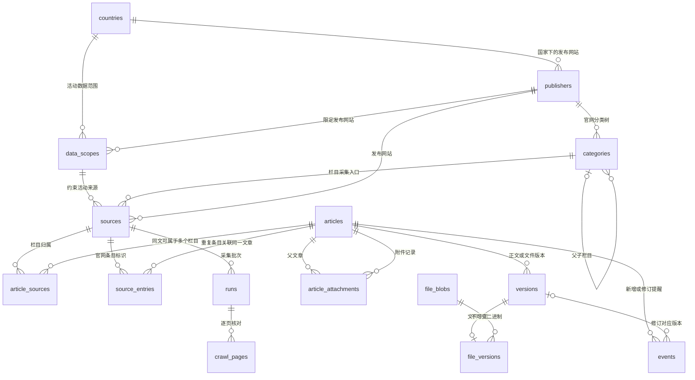

# 当前架构与数据关系

本轮范围：只运行中国出口管制信息网的五个栏目。国内政策法规下的法律（13）、法规（14）、规章及规范性文件（15）为核心政策监测；资讯动态下的国内动态（1）、国际动态（2）为辅助资讯归纳。

## 架构判断

当前保留 React + TypeScript 前端、FastAPI 业务服务、SQLite 业务数据库及 changedetection.io 正文监测引擎。这个分层适合本机单用户调试和当前五个栏目。业务分类不放在监测引擎里，前端不直接访问引擎凭证。

SQLite 文件为 `data/observatory.sqlite3`，启用 WAL 和每个连接的外键校验。结构通过 PRAGMA user_version 管理，目前为 4。版本 4 增加 `data_scopes` 关系与活动来源触发器；任何 `in_scope=1` 的来源必须绑定明确的数据范围。迁移先备份并在事务中执行，执行结束检查 foreign_key_check。

2026-11-20 已执行物理隔离：旧 `data/` 完整移入 `archive/china-scope-reset-20261120-110023/`，并另存压缩备份 `backups/observatory-20261120-110016.zip`。随后从空目录初始化活动库和引擎。当前活动库只有 `CN` 一个国家、`cn-exportcontrol` 一个发布网站、5 个活动来源；没有从旧多国库复制文章、版本、提醒、附件或监测任务。

changedetection.io 的文件存储位于 `data/engine/`，保存上游任务、历史快照和配置；它不是业务数据库。附件二进制位于 `data/attachments/`，业务库通过文件指纹引用，避免重复保存。

尚不能把当前实现视为最终多人生产架构：列表调度和同步线程仍在本机业务进程内，退出程序便停止；长时间运行、断网恢复与未来服务部署仍需继续调试。未来有多人并发写入和多实例部署需求时，再拆独立 worker 并评估 PostgreSQL；本轮不引入额外基础设施。

## 关系图

## 表的职责

| 表 | 关键字段 / 关系 | 作用 |
|---|---|---|
| countries | code 主键 | 当前活动库只有 CN；未来扩展国家时新增 |
| data_scopes | country_code、publisher_id 外键 | 明确限定活动存储范围；当前唯一值为 china-exportcontrol |
| publishers | country_code 外键 | 中国出口管制信息网等发布网站 |
| categories | publisher_id、parent_id 外键；external_code | 国内政策法规、资讯动态两个父栏目与 1/2/13/14/15 五个子栏目 |
| sources | publisher_id、category_id、scope_id 外键；in_scope、paused | 采集地址与运行设置；活动来源必须绑定数据范围 |
| articles | url 全局唯一；origin_source_id 外键 | 规范文章或附件身份；origin_source_id 只记录首次发现入口，不能用作唯一分类依据 |
| article_sources | article_id + source_id 联合主键 | 一篇文章的多个栏目归属，以及首次/最后发现时间 |
| source_entries | source_id + external_key 联合主键 | 官网给出的不同条目标识、页码、原始标题；允许多条目指向同一个文章 URL |
| article_attachments | parent_id + attachment_id 联合主键与外键 | 附件可被多篇文章引用；旧 parent_id 只保留初始发现关系，业务查询使用关联表 |
| versions | article_id 外键；article_id + stamp 唯一 | 不可变正文与文件版本记录 |
| file_blobs / file_versions | digest 唯一；version_id 与 blob_digest 外键 | 明确建立版本到文件二进制的引用，不再通过解析正文字符串查找文件 |
| events | article_id、version_id 外键 | 变更与未读状态；附件变更归集到关联父文章 |
| runs / crawl_pages | source_id、run_id 外键 | 每轮条数、逐页条数、官网报告总数、响应摘要及检查时间 |

## 分类与去重规则

1. 栏目归属来自用户指定的官网栏目 1/2/13/14/15，不根据标题关键词猜测，不额外推断现行有效性。
2. URL 相同的文章只保存一份，通过 article_sources 关联多个栏目；提醒与正文版本不按栏目重复存储。
3. 官网不同条目即使指向同一个 URL，也保留各自 external_key 与所在页。已核实规章栏目中两个不同条目标识指向同一文章，所以“官网条数”与“唯一文章数”应分开显示。
4. 首轮建立栏目历史基线，分类迁移与补录历史不会冒充新发布；以后发现的新文章和正文/附件变化才产生提醒。
5. 当前活动数据库由空库重新采集，不包含旧多国数据。旧数据库和引擎只存在于项目归档与压缩备份中。

## 当前基线

| 父栏目 | 子栏目 | 官网条目 | 唯一文章 |
|---|---|---:|---:|
| 国内政策法规 | 法律（13） | 12 | 12 |
| 国内政策法规 | 法规（14） | 16 | 16 |
| 国内政策法规 | 规章及规范性文件（15） | 108 | 107 |
| 资讯动态 | 国内动态（1） | 334 | 334 |
| 资讯动态 | 国际动态（2） | 264 | 264 |
| 合计 |  | 734 | 733 |

## 核验方式

启动后通过界面查看五个栏目各自的采集结果，也可检查 `/api/taxonomy` 和 `/api/dashboard`。数据库核验包含外键完整性、活动数据范围、URL 唯一性、各栏目条目与唯一文章数量。固定样本测试覆盖旧库迁移、范围触发器、同文多栏目、共享附件及超过三页的分页。
