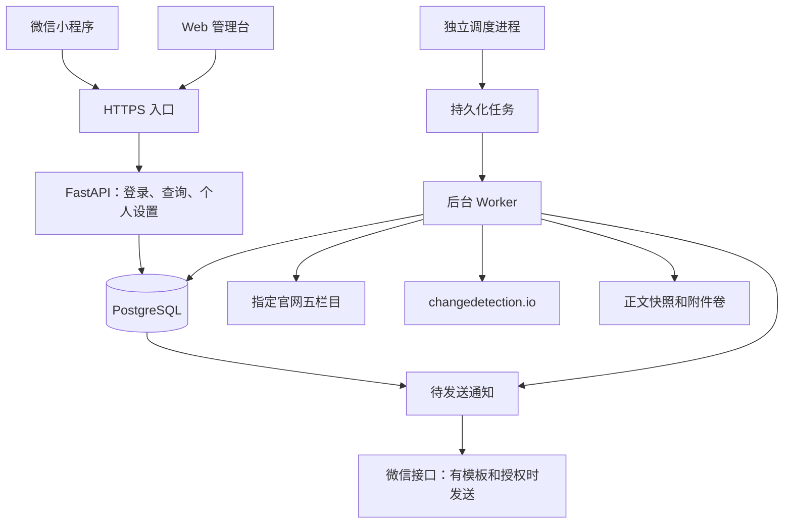

# 观澜 V2：微信小程序与服务器监测升级方案

日期：2026-11-20。状态：P1 数据迁移、独立任务、正文及附件监测核心已实施并通过开发验证；Linux 容器验收、微信账号及正式部署尚未就绪。实际进度见 backend/README.md 和 docs/V2_PROGRESS.md。

## 1. 已确认的目标

- 用户：自己和少量指定成员；邀请制，不开放公众注册。
- 客户端：微信小程序阅读、搜索、查看正文与修订、管理个人提醒。
- 服务端：部署后持续采集，与电脑、小程序是否打开无关。
- 提醒：每天固定时间汇总，重要修订单独提醒。
- 微信账号：尚未注册；主体、服务类目、可用消息模板需要先核实。
- 数据范围：保留中国出口管制信息网的五个指定栏目；不在本轮自动扩展其他国家。
- 风格：沿用苹果风格的简洁、留白、轻玻璃质感，小程序端优先阅读性能。
- 可以大改架构，但保留现有可运行基线和已采集数据。

## 2. 产品设计

小程序底部设置“动态 / 日报 / 消息 / 我的”四个入口。

| 页面 | 主要内容 |
|---|---|
| 动态 | 规章及规范性文件、法律、法规、资讯筛选；最新更新与官网顺序可切换；搜索、个人未读 |
| 文章详情 | 原标题、副标题、官方发布/发现时间、栏目归属、正文、附件、版本对比、收藏 |
| 日报 | 固定时间生成的汇总；政策与资讯分区；新增/正文修订/附件变化分别计数 |
| 消息 | 每人独立消息、已读状态、待查看修订；微信未发送的消息仍可在此查看 |
| 我的 | 关注栏目、关键词、提醒时间、安静时段、微信订阅状态、退出及账号注销入口 |
| Web 管理台 | 来源状态、覆盖审计、手动重试、成员邀请/停用、模板设置、提醒失败、备份状态 |

小程序不直接嵌入当前网页。正文由已验证的服务端内容渲染；保留原文链接复制入口。不能假定任意官网都能通过小程序 web-view 打开；外链与附件下载能力在所选主体的真机环境验证。

暂不加入 AI 法律解读、企业名单匹配、付费订阅或公众内容社区。

## 3. 微信消息是上线前的首要核实项

服务器按时生成日报和小程序内消息是可以自主实现的能力；微信服务通知还取决于账号权限、适用模板和用户授权。

腾讯云官方文档说明：一次性订阅需要用户点击后授权，授权一次可发送一条服务通知；“总是保持选择”不等于永久获得每日发送权限。不能通过自动点击、伪造授权、定时在后台请求授权来满足每日推送。

长期订阅是否适用必须在实际微信账号的类目与模板库核实，不因采用企业主体或内容来自政府网站就推定可以使用。

### 注册与验证顺序

1. 先确认用户是否有可合法使用的企业/组织主体；如果只有个人主体，按个人实际开放类目核实，不能借用不匹配的政务类目。
2. 如实描述“指定成员使用的官方政策信息监测工具”，核实适用服务类目和内容要求，不预先承诺审核通过。
3. 注册后检查公共模板库，记录可用模板 ID、类型、字段、长度、适用场景和开发/体验/正式版支持情况。
4. 做最小真机链路：用户点击授权 → 后端发送 → 实际收到 → 点击进入日报/文章。
5. 若只有一次性模板：首版明确显示“本次授权通知”，每日汇总持续生成，但微信通知按实际授权机会发送。
6. 若必须长期无人值守地收到微信提醒而模板不支持，重新选择经确认适用的通知渠道；邮件、企业微信等仅作为待选方案，用户决定后再接入。不能把其他渠道已具备视作默认条件。

开发者工具模拟成功不能作为真实微信通知验收。当前微信开发文档直链在本次检索中无法完整读取；上线前必须在实际控制台再次确认。参考：

- [腾讯云：实现小程序订阅消息推送](https://cloud.tencent.com/document/product/1301/103770)
- [腾讯云：小程序消息通知](https://cloud.tencent.com/document/practice/269/79050)
- [微信：订阅消息](https://developers.weixin.qq.com/miniprogram/dev/framework/open-ability/subscribe-message.html)
- [微信：请求订阅授权](https://developers.weixin.qq.com/miniprogram/dev/api/open-api/subscribe-message/wx.requestSubscribeMessage.html)
- [微信：发送订阅消息](https://developers.weixin.qq.com/miniprogram/dev/OpenApiDoc/mp-message-management/subscribe-message/sendMessage.html)

## 4. 架构决定



| 层 | 选择 | 理由 |
|---|---|---|
| 小程序 | Taro + React + TypeScript，编译至微信小程序 | 延续 React/TS 技术；复用类型与请求层，界面重写为小程序组件 |
| Web | 保留 React 管理台并拆组件 | 大屏处理运维、差异和来源配置；普通成员不能调用管理操作 |
| API | 保留 Python/FastAPI，建立 /api/v1 | 复用采集能力；逐步兼容现有本地接口 |
| 数据库 | V2 使用 PostgreSQL + SQLAlchemy + Alembic | 支持独立进程、多成员事务、唯一约束和有序迁移 |
| 定时 | 独立 scheduler，使用 APScheduler 计算周期 | 调度不挂在 API 生命周期；配置持久化到数据库，重启重建到期计划 |
| 任务 | PostgreSQL jobs/outbox + 独立 worker | 首版规模少，不额外引入 Redis；任务可追踪、可重试、可恢复 |
| 正文引擎 | 继续复用 changedetection.io，固定已验证版本 | 保留开源复用与历史快照能力，业务层负责来源分类、标题和提醒 |
| 文件 | 首版持久化卷，统一文件存储接口 | 便于迁移和备份；以后需要时切换对象存储 |
| 部署 | Linux + Docker Compose + HTTPS 反向代理 | 一套可复现部署，进程重启与持久化清晰 |

上述是目标技术决定，新增依赖版本在实施时按官方兼容性文档选定并锁定。V2 不直接把当前无认证的 8840/8841 端口暴露到公网。

## 5. 现有代码的保留和重构

- 保留五个官网来源、栏目树、多对多归属、同 URL 去重、正文及附件版本、采集审计和现有回归样本。
- 保留列表请求的 JSON Accept 修复、官网副标题、source_position；不能在重构时退回问号标题或按文件名猜分类。
- 将 app/service.py 中的调度、列表发现、引擎同步、文件处理拆成独立任务服务；移除 API 启动时自动开启采集线程的生产模式。
- 将 app/db.py 中 SQLite 原生 SQL、json_extract、PRAGMA、INSERT OR IGNORE 等替换为可测试的存储层和 Alembic 迁移。
- 将 app/main.py 拆为查询、身份、偏好、通知、管理接口。现有 local_only 检查不能简单删除后直接上线。
- Taro 端使用新的页面布局；旧网页的 DOM、backdrop-filter 和大块 CSS 不直接搬进小程序。

拟定目录（实施阶段创建，不代表目前已有）：

```text
app/                 过渡期保留现有本地入口
backend/
  api/ auth/ models/ repositories/
  collectors/ services/ workers/ notifications/
  migrations/
miniprogram/         Taro 小程序
frontend/            Web 管理台
deploy/              Compose、网关、环境示例、备份恢复
scripts/             导入、核验、运维
tests/               单元、集成、迁移、发送异常测试
docs/                接口契约、运行手册、验收证据
```

## 6. 身份和数据关系

通过 wx.login 获取一次性 code，由后端向微信换取身份，后端签发自己的短期会话。openid、session_key、AppSecret、access_token 不由客户端自行指定或写进小程序包。用户没有邀请资格时不能读取业务数据。

首版只有一个私人工作空间，两个角色：admin / member；不做多企业租户。

| 新增或调整对象 | 关系与职责 |
|---|---|
| users / wechat_identities / sessions | 内部用户和微信身份关联、会话过期与撤销 |
| invitations / memberships | 一次性、有时效的邀请；管理员审批及成员停用 |
| events | 保留不可变的来源变化事实，取消“全局已读”等于个人状态的设计 |
| user_event_states | user_id + event_id 唯一；每个人独立已读 |
| favorites | user_id + article_id 唯一 |
| subscriptions / preferences | 关注栏目、关键词、时区、日报时刻、安静时段 |
| subscription_grants | 记录授权回调、模板与使用状态；客户端声明不等于微信确认额度 |
| digests / digest_items | 每个汇总窗口的固定内容，不因重试重新计算成不同日报 |
| notification_outbox / delivery_attempts | 每位用户、每个事件/日报、渠道的发送意图、状态、错误码和次数 |
| jobs / schedules | 到期时间、任务键、领取租约、重试和执行审计 |

独立的副标题字段在 V2 迁移时建立，当前 description 中已采集的官网说明明确迁移为 subtitle，不与后续人工摘要混用。

## 7. 调度和提醒规则

建议默认值：来源每 6 小时检查；日报每天北京时间 18:00；时间均可配置。这些是本次规划默认值，不是用户已指定的时刻。

- 日报按前一汇总水位至本次截止水位选事件，每人只汇总其关注范围。空日报保存在程序内，默认不占用微信发送机会。
- 日报分为新增、正文修订、附件字节变化；资讯作为次要分区。保留原始发布日与发现日的区别。
- 重要修订首版采用可解释规则：核心栏目正文修订且命中用户配置规则，或管理员手动标记优先。标注触发原因，不宣称已自动判断法律影响。
- 核心栏目普通修订可在程序内醒目标记；仅字体、导航、采集选择器调整不触发政策重要修订。文件字节变化单独标明。
- 优先提醒在采集确认后生成，建议 10 分钟合并同篇变化；安静时段默认 22:00–08:00，默认顺延。规则可以配置。
- 优先提醒和日报同时引用事件时，日报标注已提醒，不重复发送相同优先通知。
- 新来源首次基线、存量数据迁移、标题核实和解析器修复不批量生成“新政策”消息。
- 来源失败不生成“今日无更新”的正常结论；日报展示最近成功检查时间和覆盖缺口。

### 持久化与防重复

任务键采用 source + 计划时隙，日报采用 user + 汇总水位，通知采用 user + digest/event + channel。数据库唯一约束防止重复写入；worker 领取任务使用事务和租约，超时后恢复未完成任务。scheduler 设置单实例锁，增加 API 实例不会增加采集次数。

事件入库与待发送通知在同一事务写入；发送在事务外完成，避免网络阻塞数据库事务。断网重试采用退避与次数上限，授权/模板无效时停止自动重试并显示待处理。

微信返回成功只记录“接口受理”，不能直接显示用户已读。若请求超时且是否发送未知，记录 unknown，避免立即盲目重试造成重复通知。跨外部接口不能承诺严格 exactly-once；明确失败与不确定发送分开处置。

## 8. 存量迁移与回退

1. 记录活动 SQLite 结构版本（当前 v5）、每表数量、外键、正文/文件指纹及引擎 watch 映射。
2. 在独立测试 PostgreSQL 导入，保留文章 ID、URL、栏目关系、官网条目标识、顺序、版本、附件关系、发现/发布/采集时间。
3. 当前全局已读仅映射给原拥有者；新成员建立自己的阅读基线。历史导入不发送微信消息。
4. 对照导入前后每表数量、唯一约束、外键、版本内容哈希与附件文件；抽查法律/法规/规章及资讯。
5. 正式切换前暂停旧写入，做一致性停机备份，再执行最终导入；切换后只运行一套生产调度。
6. 保留原始 SQLite、引擎数据及附件备份。代码回退与数据库恢复分开执行；不运行未经验证的降级迁移，不把 Git 回退当成数据恢复。

V2 开发与调试使用独立目录、数据库和微信开发配置。当前本机版继续可运行，避免真实与测试事件混入。

## 9. 部署与运维

Compose 计划拆成 gateway、api、scheduler、worker、postgres、changedetection 六个服务；worker 初期单实例。数据库和引擎仅内网可达，外部通过 HTTPS API。

- 配置通过环境变量/部署密钥管理；仓库只提交空值示例。
- 先在本地容器验收，再部署测试环境，再真机体验版，最后决定正式发布。
- 域名、HTTPS、微信合法请求/下载域名、所选地区和主体对应的备案/平台要求，在账号就绪后按官方控制台核实。体验版不能作为永久免审的发布替代方案。
- 监控来源最后成功时间、积压任务、租约过期、引擎连通、存储容量、微信授权不足和发送失败。
- 每日一致性备份 PostgreSQL、引擎配置与附件引用；设置保留策略，并在独立目录实际恢复验收。代码使用 Git 管理，数据独立备份。
- 首轮以单机部署控制复杂度，容量根据真实抓取、文件体积和内存实测确定；本次不购买云资源或承诺费用。
- 小程序仅采集身份和功能所需设置，不默认申请手机号、通讯录或定位；账号注销后的个人记录按已声明策略处理。

## 10. 分阶段开发与验收

| 阶段 | 工作 | 通过条件 |
|---|---|---|
| P0 Git 与平台可行性 | Git 基线、升级分支、方案；注册主体/模板核实；真机消息小样 | 可回退；消息权限有真实证据；不先承诺无限推送 |
| P1 服务器基础 | 存储层、PostgreSQL/Alembic、任务/调度拆分、部署配置、SQLite 导入 | API 重启不丢任务；重复调度不重复入库；旧数据核验通过 |
| P2 小程序与成员 | 微信登录、邀请制、列表/详情/附件、个人未读、Web 管理权限 | 两个测试成员阅读互不影响；无邀请不能访问；真机查阅成功 |
| P3 汇总与发送 | 日报窗口、规则提醒、outbox、授权状态、微信适配 | 授权后实际接收并跳转；拒绝/耗尽/超时/重试均可追踪；历史无通知风暴 |
| P4 上线验收 | 测试部署、备份恢复、负载、断网重启、体验版/正式审核准备 | 连续运行至少 72 小时且覆盖多个真实调度周期；备份真实恢复；回退演练通过 |

研发工作量初估 12–20 个工作日当量；账号注册、类目/模板、域名及审核等待另计。阶段以验收条件为准，不承诺固定上线日。

P1 已实现独立后端监测及迁移核验；P2 已实现邀请制成员接口和小程序工程，通过后端回归、类型检查及微信目标构建，真实微信登录与真机待联调。P0 的账号与消息核实并行推进，具体证据见 docs/V2_PROGRESS.md；正式部署与通知发送尚未验收。

## 11. 后续需要用户参与的节点

- 确认实际可使用的注册主体，完成微信实名认证/扫码，最终选定合适类目与模板。
- 部署前确认服务器、域名、地区与预算；账号凭证通过本机安全配置提供，不发进聊天或提交仓库。
- 若微信消息不能满足持续提醒，确认是否启用备用通知渠道。
- 如需异地代码备份，指定 GitHub/Gitee 私有仓库；本次仅建立本地仓库，未上传。
